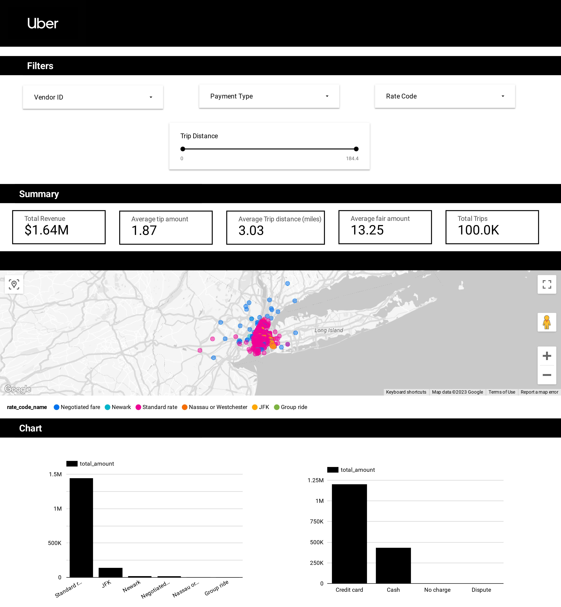
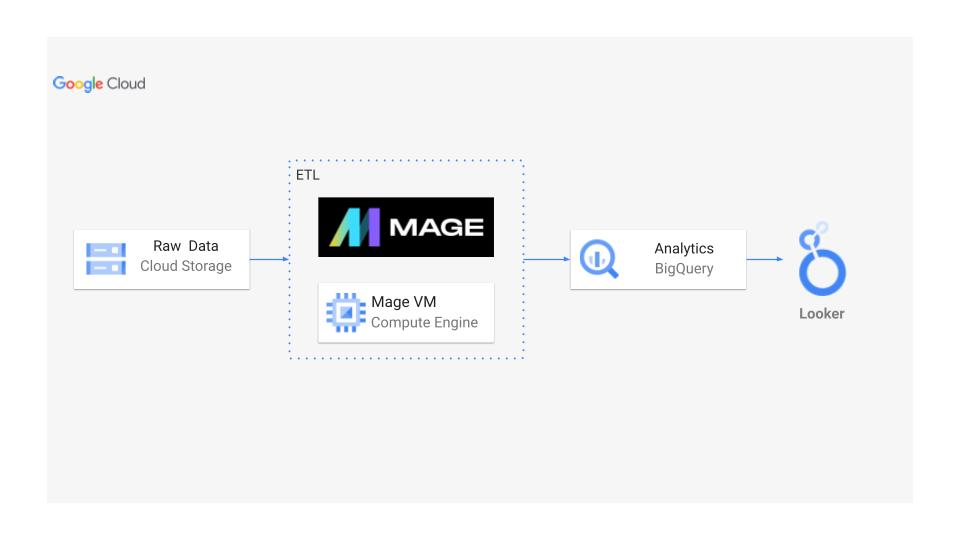
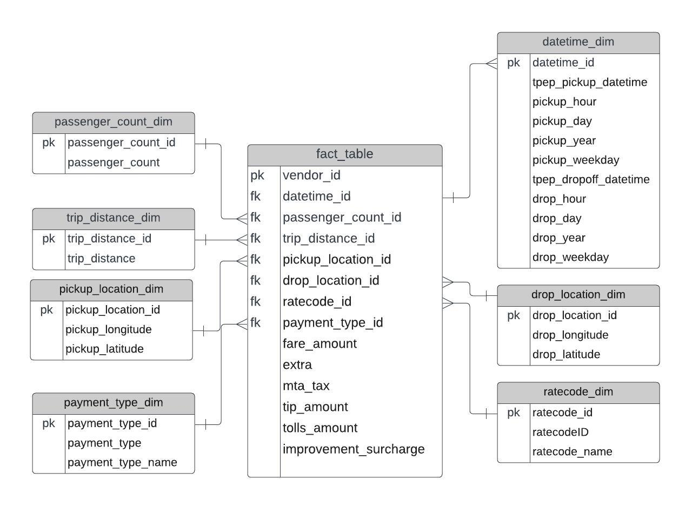

# 🚕 Uber Data Analytics: End-to-End ETL Pipeline on GCP

> A data engineering project that pulls raw NYC trip records, models them into a star schema with Python, loads them into BigQuery using a Mage pipeline running on a GCP Compute Engine VM, and visualizes the results in a Looker Studio dashboard.



---

## 📌 Overview

This project builds a complete batch ETL pipeline on Google Cloud Platform:

1. **Extract**: raw trip data (CSV) is stored in **Google Cloud Storage** and loaded over HTTP.
2. **Transform**: **Python / pandas** inside a **Mage** pipeline cleans the data and models it into a **star schema** with 1 fact table and 7 dimension tables.
3. **Load**: the tables are exported to **BigQuery**.
4. **Analyze**: SQL in BigQuery joins the schema into one flat analytics table.
5. **Visualize**: **Looker Studio** connects to that table to build an interactive dashboard.

---

## 🏗️ Architecture



---

## 🧰 Tech Stack

| Layer | Tool |
|-------|------|
| Language | Python (pandas) |
| Storage | Google Cloud Storage |
| Compute | Google Compute Engine (VM hosting Mage) |
| Orchestration | [Mage](https://www.mage.ai/) |
| Data warehouse | Google BigQuery |
| Visualization | Looker Studio |
| Modeling and prototyping | Jupyter Notebook |

---

## 📊 Dataset

The dataset is [NYC TLC Trip Record Data](https://www.nyc.gov/site/tlc/about/tlc-trip-record-data.page) (yellow taxi). The sample in `data/uber_data.csv` contains **100,000 trips** from **1–10 March 2016**.

Each record includes:
- Pickup and drop-off timestamps
- Pickup and drop-off coordinates (latitude and longitude)
- Trip distance and passenger count
- Rate code and payment type
- Itemized fare: fare, extra, MTA tax, tip, tolls, improvement surcharge and total

The [data dictionary](https://www.nyc.gov/assets/tlc/downloads/pdf/data_dictionary_trip_records_yellow.pdf) lists every field.

---

## 🗂️ Data Model

The flat CSV is modeled as a **star schema**: one central `fact_table` that holds the fare measures, surrounded by descriptive dimension tables.



| Table | Contents |
|-------|----------|
| `fact_table` | Vendor, foreign keys to every dimension, and all fare amounts |
| `datetime_dim` | Pickup and drop-off timestamps split into hour, day, month, year and weekday |
| `passenger_count_dim` | Passenger count |
| `trip_distance_dim` | Trip distance |
| `rate_code_dim` | Rate code mapped to a name (Standard, JFK, Newark, Nassau/Westchester, Negotiated, Group) |
| `payment_type_dim` | Payment type mapped to a name (Credit card, Cash, No charge, Dispute, Unknown, Voided) |
| `pickup_location_dim` | Pickup latitude and longitude |
| `dropoff_location_dim` | Drop-off latitude and longitude |

---

## 🔄 Pipeline


The Mage pipeline has three blocks, stored in [`Mage files/`](Mage%20files):

| Block | File | What it does |
|-------|------|--------------|
| **Data Loader** | `load.py` | Downloads the CSV from a public GCS URL into a pandas DataFrame |
| **Transformer** | `transform.py` | Parses the datetimes, removes duplicates, builds the 7 dimensions plus the fact table, and maps code values to readable names |
| **Data Exporter** | `export.py` | Writes each table to BigQuery (`if_exists='replace'`) using Mage's `io_config.yaml` |

After loading, [`Bigquery.sql`](Bigquery.sql) joins the fact table with all the dimensions into `tbl_analytics`, the flat table that powers the dashboard.

---

## 📁 Project Structure

```
Uber_ETL_data_analytics/
├── data/
│   └── uber_data.csv          # Raw trip data (100k rows)
├── Mage files/
│   ├── load.py                # Extract
│   ├── transform.py           # Transform (star schema)
│   └── export.py              # Load to BigQuery
├── ETL_pipline.ipynb          # Notebook used to prototype the data model
├── Bigquery.sql               # Builds the flat analytics table
└── Images/                    # Architecture, data model, pipeline, dashboard
```

---

## 🚀 Getting Started

### Prerequisites
- A Google Cloud project with billing enabled
- A **GCS bucket**, a **BigQuery dataset** and a **Compute Engine VM** (an e2-standard-4 running Debian works well)
- A service account with BigQuery access, and its JSON key

### Steps

1. **Upload the data** to your GCS bucket and make the object publicly readable (or use authenticated access):
   ```bash
   gsutil cp data/uber_data.csv gs://<your-bucket>/uber_data.csv
   ```

2. **Set up the VM** and install Mage:
   ```bash
   sudo apt-get update && sudo apt-get install -y python3-pip
   pip3 install pandas mage-ai google-cloud google-cloud-bigquery
   mage start <project_name>
   ```
   Open the firewall for port **6789** and go to `http://<VM_EXTERNAL_IP>:6789`.

3. **Create the pipeline** in Mage with three blocks (Data Loader, Transformer and Data Exporter), pasting in the code from `Mage files/`.

4. **Update the placeholders**:
   - `load.py`: set `url` to `https://storage.googleapis.com/<your-bucket>/uber_data.csv`
   - `export.py`: set `table_id` to `<your-project-id>.<your-dataset>.{k}`
   - `Bigquery.sql`: replace the project and dataset names

5. **Add your credentials** to Mage's `io_config.yaml` under `GOOGLE_SERVICE_ACC_KEY` (or point `GOOGLE_SERVICE_ACC_KEY_FILEPATH` at the key file).

6. **Run the pipeline**, then run `Bigquery.sql` in the BigQuery console to create `tbl_analytics`.

7. **Build the dashboard** in Looker Studio with `tbl_analytics` as the data source.

---

## 💡 Key Insights

- **Standard rate** trips bring in the most revenue, making it the most popular rate type.
- Trips to **Newark** have the highest average tip, at about **$11**.
- **Credit cards** account for about **75%** of payments, followed by cash.
- **Single-passenger** trips make up about **66%** of all rides.
- The top pickup area is around **Jackson Ave near Queens Plaza, Long Island City**.
- Fares peak at **2 PM** and are lowest at **7 AM**.

---

## 🛣️ Possible Improvements

- [ ] Schedule the pipeline with Mage triggers for incremental daily loads
- [ ] Replace raw coordinates with TLC taxi-zone IDs for cleaner location analysis
- [ ] Partition and cluster the BigQuery tables by pickup date
- [ ] Add data-quality checks (null, range and duplicate tests) in Mage
- [ ] Manage the GCP infrastructure as code with Terraform